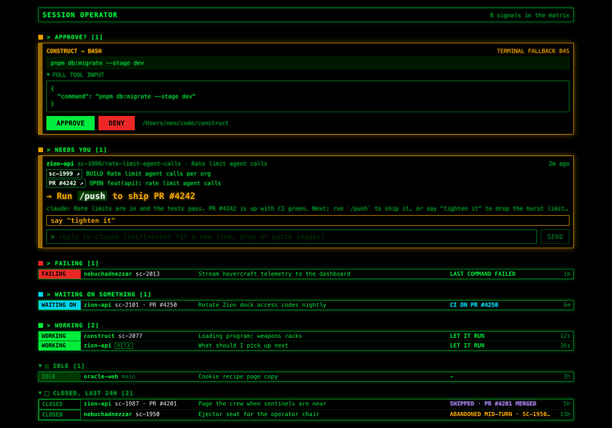

# session operator

One calm page for all the Claude Code sessions running on this Mac. It shows what each
session is doing, and when one needs a permission you can approve or deny it here.



<sub>Demo data. The sessions, cards and PRs in the screenshot are made up.</sub>

## Run it

Needs macOS, Node, pnpm, the `claude` CLI and `gh` (logged in). Replies and ending
sessions type into iTerm2 or tmux (tmux inside iTerm2 works too); other terminals can
still watch, approve and answer.

```sh
pnpm install
bin/sop setup   # hooks into ~/.claude/settings.json, sop into ~/.local/bin (--dry-run to preview)
pnpm dev        # server on 127.0.0.1:4477, UI on http://127.0.0.1:5178
```

Or build once and serve everything from the server:

```sh
pnpm build && pnpm start   # http://127.0.0.1:4477
```

Env vars:

- `OPERATOR_PORT` - server port (default 4477)
- `OPERATOR_NOTIFY=0` - turn off macOS notifications
- `OPERATOR_URL` / `OPERATOR_TIMEOUT_MS` - read by `bin/operator-hook` (defaults `http://127.0.0.1:4477`, `3600000`)
- `OPERATOR_TERMINAL=tmux` - make `sop start` open sessions in tmux instead of iTerm2 tabs
- `SHORTCUT_API_TOKEN` - only if you track work in Shortcut

## Cards, issues and PRs

Each session shows the work it's for, found from its branch:

- **GitHub PRs** - the PR whose head is the session's branch, with its state.
- **GitHub issues** - a branch that leads with the issue number (`123-fix-login`, what
  `gh issue develop` makes; also `issue-123-...`, `feat/123-...`), plus any issue the
  branch's PR closes ("Closes #123", or `owner/repo#123` in another repo). If the issue is on
  a GitHub Project, its Status column shows as the state, and Done counts as shipped, unless
  it was closed as not planned. That needs `gh auth refresh -s read:project`; without it you
  get open/closed/done.
- **Shortcut cards** - a branch that names one (`sc-123/...`), when `SHORTCUT_API_TOKEN` is set.

Cards, issues and PRs that Claude only mentions are listed separately and link out too.
`sc-123`, `PR #123`, `owner/repo#123` and full GitHub or Shortcut URLs link wherever they
appear; a bare `#123` only links once it turns out to be a real issue or PR in the session's
repo.

## The operator

`sop operator` starts a Claude Code session whose job is running the others. It gets its
instructions from `docs/operator-prompt.md` and drives everything through `sop`:

```sh
sop ls                                   # every session: status, card, what it needs
sop feed sc-8121                         # a session's last messages
sop say sc-8121 "go with option 1"       # type into a session
sop end sc-8121                          # /exit and close its tab
sop start ~/code/app --worktree sc-8121/foo "start sc-8121"   # worktree + tab + claude
```

Put it on your PATH (`ln -s "$PWD/bin/sop" ~/.local/bin/sop`), then run `sop operator` in
any terminal tab. The page pins it in its own strip at the top.

**Nudges.** When a session has needed you for 2 minutes (finished with a question, waiting
on a prompt, or failing), the server types one bundled `[operator nudge]` line into the
operator, which tells you what each one needs. Each state nudges once, at most one message
every 2 minutes, never while the operator is mid-turn. `OPERATOR_NUDGES=0` turns them off.

The operator relays; it doesn't decide. It won't answer a worker for you, approve
anything, or tell one to merge, deploy or post anywhere.

## How it works

```
Claude Code ──hook stdin──▶ bin/operator-hook ──POST /api/hook──▶ server (127.0.0.1)
                                  ▲                               │  in-memory pending queue
                                  └──── long-poll /wait ◀─────────┤  + transcript scan
                                                                  ▼
                                               React UI (SSE /api/events + /api/state)
```

- **Sessions** come from `~/.claude/projects/*/*.jsonl` modified in the last 24h. Only the
  tail of each file is read, and only a few fields are kept: cwd, git branch, AI title,
  last prompt (clipped to 160 chars), and the latest turn record. Nothing in a transcript
  is ever executed.
- **Status** comes from the latest turn record, then hook events override it when they
  are newer. Colors: orange = needs you, red = failing, green = working, gray = idle.
  - waiting (orange) - a permission request is pending, or a `Notification` hook fired
  - done (orange, "your move") - the turn ended within the last hour
  - failing (red) - stuck mid-turn for 10+ min, the last tool result was an error, or the
    latest record is an API error
  - working (green) - mid-turn with recent activity
  - idle (gray) - anything quieter, including sessions stopped mid-turn over an hour ago
- **Approvals.** On `PermissionRequest`, `operator-hook` posts the payload, the server queues
  it and fires a macOS notification, and the hook long-polls for your click. Approve, Deny,
  or one of Claude Code's own "don't ask again" rules becomes the hook's JSON decision. The
  terminal shows the same prompt meanwhile; answer it there and the deck drops the card.
- **Fail-safe.** The hook never approves on its own. If the server is down, errors, or
  nobody clicks before `OPERATOR_TIMEOUT_MS` (an hour), the hook exits 0 with no output and
  the terminal prompt carries on alone.
- **Localhost only.** The server binds 127.0.0.1, rejects other Host headers (DNS
  rebinding) and non-localhost Origins, and POSTs must be `application/json`. No auth
  past that.
- State is in memory. Restarting the server drops pending requests, and their hooks
  register them again once it's back.

API: `POST /api/hook`, `GET /api/state`, `POST /api/decisions/:id` with
`{"behavior":"allow"|"deny"}`, `GET /api/decisions/:id/wait`, `GET /api/events` (SSE).

## Hook setup

`bin/sop setup` does this for you: it merges these into `~/.claude/settings.json` next to
any hooks you already have, with this checkout's path, and backs the file up first. By
hand, it's:

```json
{
  "hooks": {
    "PermissionRequest": [
      { "hooks": [{ "type": "command", "command": "$HOME/code/ai/session-operator/bin/operator-hook", "timeout": 3660 }] }
    ],
    "Notification": [
      { "hooks": [{ "type": "command", "command": "$HOME/code/ai/session-operator/bin/operator-hook", "timeout": 5 }] }
    ],
    "Stop": [
      { "hooks": [{ "type": "command", "command": "$HOME/code/ai/session-operator/bin/operator-hook", "timeout": 5 }] }
    ],
    "UserPromptSubmit": [
      { "hooks": [{ "type": "command", "command": "$HOME/code/ai/session-operator/bin/operator-hook", "timeout": 5 }] }
    ],
    "SessionEnd": [
      { "hooks": [{ "type": "command", "command": "$HOME/code/ai/session-operator/bin/operator-hook", "timeout": 5 }] }
    ]
  }
}
```

The `PermissionRequest` timeout (3660s) needs to be above `OPERATOR_TIMEOUT_MS` (an hour)
plus one 25s poll, so the hook lets go on its own before Claude Code kills it. Killed
would still be safe though, the terminal prompt is up the whole time.

## Try it without installing the hook

```sh
pnpm start &
echo '{"hook_event_name":"PermissionRequest","session_id":"demo","cwd":"/tmp/demo","tool_name":"Bash","tool_input":{"command":"ls"}}' \
  | bin/operator-hook
# click Approve at http://127.0.0.1:4477 and the hook prints its decision JSON
```
